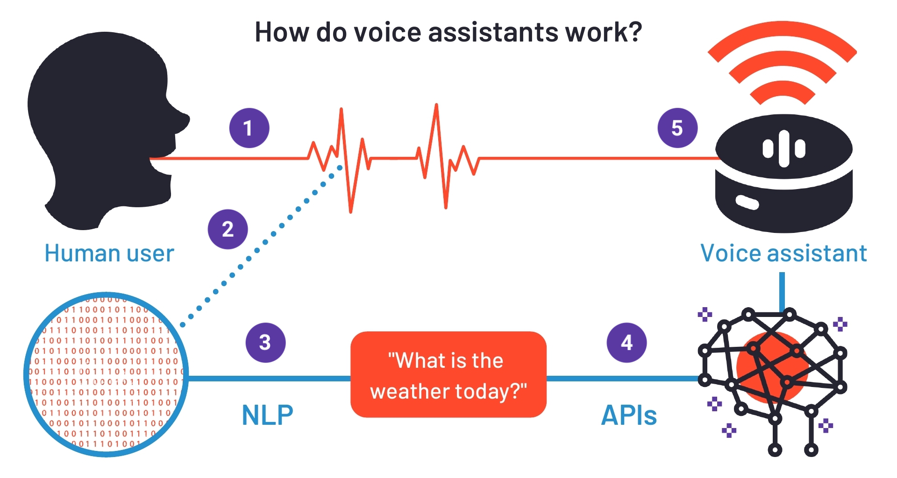
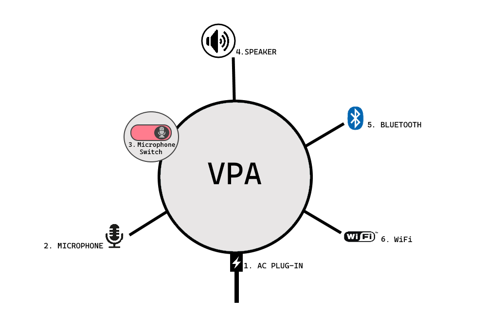
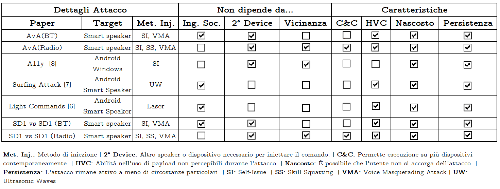
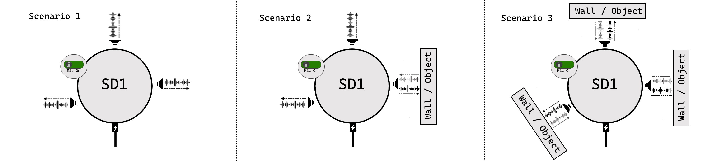
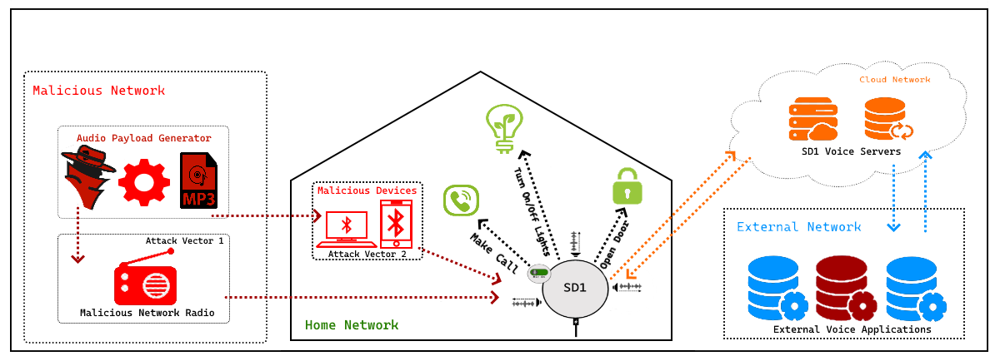
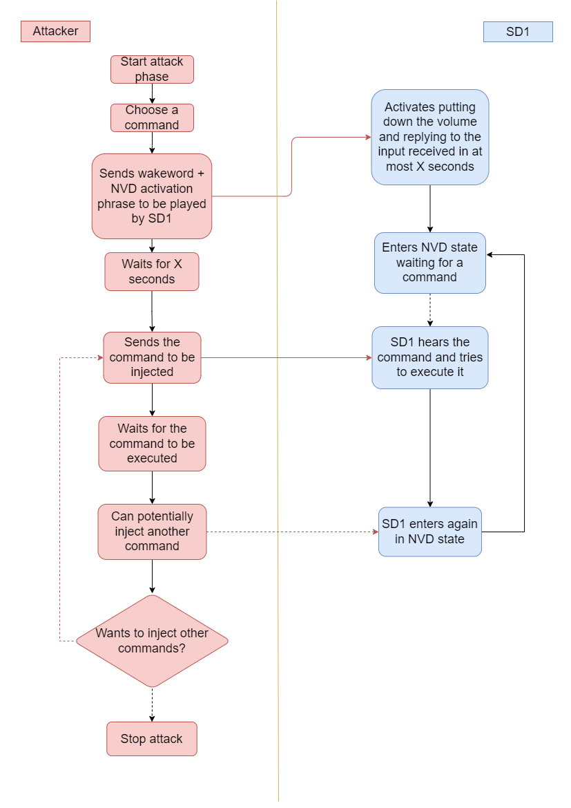
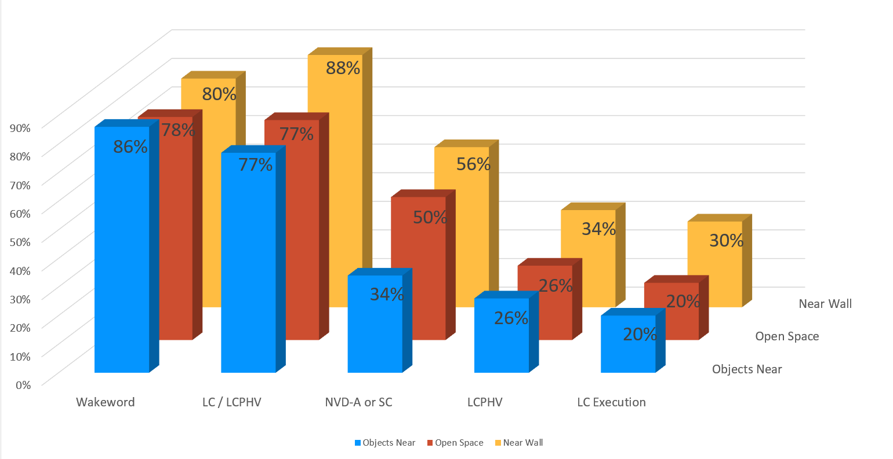
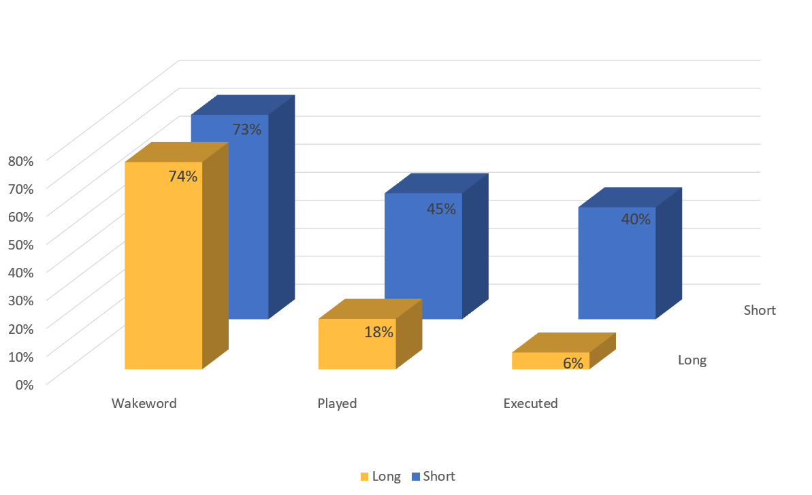
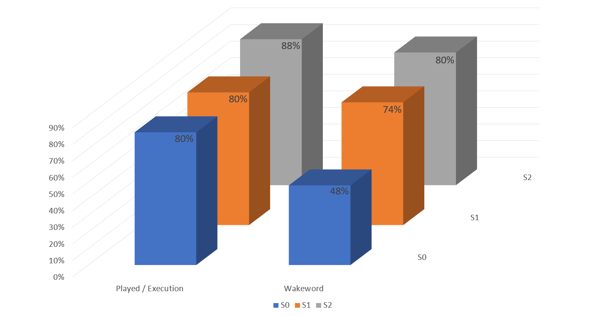

<p align="center"></p>

<p align="center">
<strong>Università degli Studi di Catania</strong><br>
Dipartimento di Matematica e Informatica<br>
Corso di Laurea Magistrale in Informatica
</p>

# Self-Injection di Comandi Vocali Non Autorizzati sul Google Nest Mini

<p align="center"><em>— Tesi Sperimentale —</em></p>

<p align="center">Salvatore Graci</p>

<p align="center">
<strong>Relatore:</strong> Chiar.mo Prof. Giampaolo Bella<br>
<strong>Correlatori:</strong> Dott. Sergio Esposito, Dott. Pietro Biondi
</p>

<p align="center">Anno Accademico 2021/2022</p>

---

## Indice

1. [Introduzione](#1-introduzione)
   - 1.1 [Voice Personal Assistants (VPA)](#11-voice-personal-assistants-vpa)
     - 1.1.1 [Hardware di un VPA](#111-hardware-di-un-vpa)
     - 1.1.2 [Funzionalità di un VPA](#112-funzionalità-di-un-vpa)
   - 1.2 [Struttura dell'elaborato](#12-struttura-dellelaborato)
2. [Attacco allo specifico VPA Google Nest Mini](#2-attacco-allo-specifico-vpa-sd1)
   - 2.1 [Attacchi correlati contro VPA](#21-attacchi-correlati-contro-vpa)
   - 2.2 [Modello di attaccante](#22-modello-di-attaccante)
   - 2.3 [Payload Audio](#23-payload-audio)
   - 2.4 [Flusso di esecuzione malevolo](#24-flusso-di-esecuzione-malevolo)
   - 2.5 [NVD - No Volume Down bug](#25-nvd---no-volume-down-bug)
   - 2.6 [Esecuzione dell'attacco](#26-esecuzione-dellattacco)
     - [Dimostrazione video](#dimostrazione-video)
   - 2.7 [Impatto generato sull'utente](#27-impatto-generato-sullutente)
3. [Valutazione dei risultati](#3-valutazione-dei-risultati)
   - 3.1 [Statistiche sull'attacco usando NVD](#31-statistiche-sullattacco-usando-nvd)
   - 3.2 [Confronto dell'attacco senza uso di NVD](#32-confronto-dellattacco-senza-uso-di-nvd)
   - 3.3 [Confronto con diverse impostazioni di sensibilità](#33-confronto-con-diverse-impostazioni-di-sensibilità)
   - 3.4 [Limiti](#34-limiti)
   - 3.5 [Contromisure](#35-contromisure)
4. [Conclusioni](#4-conclusioni)
5. [Bibliografia](#bibliografia)

---

## 1. Introduzione

L'industria dei dispositivi IoT ed in particolare quella dei dispositivi "smart home" ha raggiunto negli ultimi anni un livello molto alto di commercializzazione. Basti pensare che nel solo trimestre Ottobre - Dicembre 2020 sono stati venduti più di 41 milioni di questi dispositivi nella sola Europa e si stima che questi possano crescere fino a 210 milioni durante tutto il 2025 [1].

I dispositivi che fanno parte di questa famiglia cercano sempre più di integrarsi tra loro e con l'utente al fine di fornire a questo supporto ed intrattenimento all'interno della sua casa e nell'esecuzione delle azioni quotidiane. L'utente riesce quindi ad ascoltare musica o la radio, interagire con luci, serrande, televisori e allarmi; oppure farsi ricordare le attività del giorno, fare acquisti online e persino farsi aiutare nella preparazione dei piatti preferiti. Tutto ciò è reso possibile anche grazie agli smart speaker, che integrano gli assistenti vocali quali ad esempio Amazon Alexa [2] e Google Assistant [3] e che agiscono in tutto e per tutto come i nostri assistenti personali, detti Voice Personal Assistant (VPA).

Senza dubbio, la freneticità delle nostre vite nella quotidianità, la ricerca di soluzioni comode per facilitare ed aiutare l'utente in alcuni compiti ma anche l'estrema facilità di utilizzo dei VPA, sono soltanto alcuni dei motivi per cui l'impatto commerciale di questi dispositivi è stato così alto, sin dalla loro nascita. Tra questi aspetti non manca di certo la qualità delle azioni che compiono i VPA. La loro capacità di compiere azioni e rispondere all'utente aumenta costantemente grazie all'utilizzo delle migliori tecniche di machine learning. Più queste tecniche diventeranno potenti e più saranno i dati raccolti nel tempo, più numerose saranno le azioni che questi dispositivi saranno in grado di offrire, nonché migliori saranno le risposte che potranno restituire all'utente, al pari di un assistente umano.

Chiaramente, l'avanzamento tecnologico nel campo dei VPA ha fornito molto materiale sia agli hacker che ai ricercatori che si occupano di sicurezza informatica. Infatti, oggigiorno, si sente sempre più spesso parlare di violazione di smart device in generale, e di conseguenza dei VPA. Un esempio di violazione su smart device è quella effettuata su uno dei frigoriferi smart di Samsung nel 2015 [4]. Un'altra di queste violazioni sarà proprio l'oggetto di questo elaborato, dove sarà evidenziato come un utilizzo improprio dei VPA possa portare a dei problemi per l'utente. Il produttore del dispositivo, Google, è stato messo a conoscenza del problema; a distanza di tempo ha dichiarato di non ritenerlo un problema di sicurezza rilevante.

### 1.1 Voice Personal Assistants (VPA)

Per dare un contesto più chiaro al lettore possiamo dare delle definizioni più precise sui VPA. Si tratta di smart device che riescono a loro volta a connettersi con altri dispositivi compatibili della rete che diventano quindi utilizzabili e controllabili tramite comandi vocali in diverse lingue. L'utente parla quindi normalmente e la sua voce viene ricevuta dal VPA. Se ciò che viene ricevuto contiene un comando di attivazione vocale o *wakeword* (specifico al dispositivo che si sta utilizzando), allora i successivi dati vocali vengono inviati per l'elaborazione su dei server dedicati. Tale elaborazione avviene tramite degli algoritmi di machine learning che interpretano ciò che è stato detto dall'utente al fine di restituire al dispositivo il risultato, contenente le azioni che questo deve intraprendere.

Il dispositivo è adesso in grado di compiere un'azione verso un altro dispositivo della stessa rete o dare una risposta vocale tramite una voce sintetizzata. Nella seguente Figura 1.1 [5] si trova un esempio dello schema di funzionamento appena descritto, riferito ad un generico assistente vocale.

<p align="center"></p>
<p align="center"><em>Figura 1.1: Funzionamento di un assistente vocale</em></p>

Le azioni che attualmente si possono chiedere a questi dispositivi non sono poche, ma giorno dopo giorno vengono aggiunte nuove feature e dispositivi compatibili, facendo sì che tramite i VPA l'utente sia in grado di compiere molte più azioni.

#### 1.1.1 Hardware di un VPA

Altro aspetto importante da studiare è la composizione hardware dei VPA. Questi sono composti da diversi componenti e alcuni possono anche variare da modello a modello e da produttore a produttore. In questo elaborato andremo ad evidenziare le sole componenti essenziali di questi dispositivi e generalmente comuni a tutti quelli presenti sul mercato.

Andando nel dettaglio quindi diremo che un VPA è un oggetto con forme di design, che contiene al suo interno dei componenti elettronici che gli permettono di espletare tutte le sue funzionalità. Con riferimento alla Figura 1.2 di seguito viene fornita una descrizione di tali componenti hardware di base. Il primo ad essere citato è ovviamente il connettore di alimentazione AC (1) o di ricarica (nel caso di alimentazione a batterie).

A seguire è possibile trovare uno o più microfoni (2), con cui il dispositivo ascolta l'ambiente circostante in attesa che gli vengano richiesti dei comandi da eseguire. Questo gruppo di microfoni per motivi di privacy può essere manualmente disattivato o riattivato dall'utente tramite un tasto on-off (3) che permette quindi di negare l'ascolto al dispositivo, di modo che l'utente possa decidere quando permettergli di ascoltare e ricevere comandi oppure no.

Sono presenti poi uno o più speaker (4) con i quali il dispositivo riesce a comunicare con l'utente, fornendo le risposte richieste o informazioni sul comando rilevato (ad esempio se questo non viene riconosciuto o necessita di un'ulteriore interazione da parte dell'utente).

Troviamo infine due schede di connettività, che effettuano operazioni simili ma comunque differenti ed indispensabili, il Bluetooth (5) ed il WiFi (6). Tramite il primo è possibile configurare inizialmente il dispositivo, permettendogli di connettersi alla rete WiFi per poi navigare in rete ed effettuare l'interpretazione dei comandi o le ricerche. Inoltre tramite lo stesso è possibile permettere la riproduzione di audio proveniente da altri dispositivi come telefoni cellulari e PC. Il secondo permette il funzionamento del VPA, consentendogli di interpretare online i dati captati tramite il microfono, agire sui dispositivi WiFi della casa, e rispondere alle varie domande poste dall'utente.

<p align="center"></p>
<p align="center"><em>Figura 1.2: Hardware interni al VPA</em></p>

#### 1.1.2 Funzionalità di un VPA

Nelle precedenti parti introduttive dell'elaborato sono state evidenziate le caratteristiche principali di un VPA e le sue funzioni più basilari. In questa sezione si proverà ad entrare nelle specifiche funzionalità possedute attualmente da un VPA, che non si limitano alla funzione di speaker e alla restituzione di informazioni all'utente. La funzionalità cardine di questo tipo di dispositivi è infatti quella di interagire con gli altri dispositivi della casa.

Nell'ambito della sicurezza informatica, quindi, si devono analizzare non solo le implicazioni sulla privacy per l'utente, ma anche tutti i rischi che possono derivare da questo flusso di dati interno alla rete e di come questo scambio di informazioni avvenga. Ciò definisce, di conseguenza, le armi possedute da un attaccante e utilizzabili per sfruttare questa alta connettività a proprio vantaggio.

Ad oggi sono di uso comune diversi dispositivi smart all'interno delle case controllabili tramite VPA, spesso collegati ai sistemi domotici. Questi sistemi permettono di accendere e spegnere le luci della casa, alzare o abbassare le serrande, azionare i sistemi di allarme ed anche aprire le porte di casa. Questi differiscono da altri dispositivi smart come gli smartphone o i sistemi smart in ambito automotive, come l'infotainment [6], oppure ancora smart watch o tags o dispositivi medici smart come il pacemaker sviluppato da CResPace [7] che regola automaticamente le sue funzioni basandosi sui dati raccolti ed elaborati da reti neurali.

Tra questi dispositivi domotici, si nota facilmente come alcuni siano estremamente importanti per la sicurezza fisica della casa in cui vengono installati. Un VPA è in grado di collegarsi al sistema domotico e di azionare tali dispositivi tramite i comandi vocali, aggiungendo però dei rischi.

I VPA non si connettono soltanto ai sistemi domotici, ma anche ad altri dispositivi smart. Troviamo frigoriferi, lavatrici, lavastoviglie, caffettiere, televisioni e diversi dispositivi di riproduzione. Tutti controllabili tramite comandi vocali. Basterà dire "Speaker, accendi la lavastoviglie alle cinque" oppure "Speaker, apri la porta di casa" per far sì che il VPA percepisca la nostra richiesta e la esegua. Si noti come in questi esempi "Speaker" sia la wakeword ed il resto sia il comando da eseguire.

Non ci si limita solo a questo: alcuni dispositivi riescono anche a collegarsi ai nostri account personali di e-commerce o alla nostra app bancaria permettendoci ad esempio di dire "Speaker, compra ciò che ho inserito nel carrello" e di ritrovarci i nostri nuovi oggetti a casa l'indomani. Inoltre, possiamo chiedere di riprodurre la nostra serie TV preferita su uno specifico dispositivo. Infine, alcuni di questi dispositivi permettono facilmente ai programmatori di creare delle nuove funzioni per specifiche applicazioni e renderle disponibili in tutto il mondo.

Un attaccante con conoscenza di questi dispositivi potrebbe pensare di sfruttare tutto questo per i propri scopi illeciti e di seguito in questo elaborato se ne potrà individuare uno.

### 1.2 Struttura dell'elaborato

In questa breve sezione si vuole dare un'informazione più dettagliata della struttura che segue nel presente elaborato. In particolare, si affronteranno due tematiche principali, divise nei seguenti due capitoli. La prima, che è possibile trovare al Capitolo 2, riguarda l'attacco portato verso il VPA oggetto di questo elaborato. La seconda tematica, che verrà trattata al Capitolo 3, riguarderà invece i risultati ottenuti utilizzando l'attacco trovato contro il VPA in questione e l'impatto che questo può avere sugli utenti che lo utilizzano in attesa che il produttore studi il caso al fine di produrre un eventuale fix.

Parte centrale dell'elaborato sono le specifiche dell'attacco studiato, per cui nel prossimo capitolo si evidenzierà lo scenario in cui ci si pone e quindi il modello studiato, le condizioni che definiscono le sue probabilità di riuscita ed infine come questo viene portato a termine, anche interagendo con il dispositivo VPA da remoto.

---

## 2. Attacco allo specifico VPA Google Nest Mini

In questo capitolo verranno analizzati nel dettaglio i problemi riscontrati sullo smart speaker studiato, il Google Nest Mini. Successivamente, si vedrà come sia possibile effettuare un attacco con payload auto iniettabile contro questo. Verrà inoltre descritto l'impatto negativo a cui sono esposte le vittime di questo attacco e i pericoli che ne possono derivare. Inoltre, l'attaccante non necessita di particolari strumenti per poterlo effettuare: in base al vettore d'attacco scelto, infatti, all'attaccante potrebbero bastare pochi secondi in prossimità di Google Nest Mini avendo con sé un qualunque dispositivo dotato di connettività Bluetooth. Non è da escludere uno sfruttamento diversificato e su larga scala della vulnerabilità, tramite delle radio o della musica gestite dall'attaccante che, associati ad attacchi di social engineering o del tutto nascosti in audio all'apparenza innocui, potrebbero portare diversi utenti ad essere vittime contemporaneamente.

### 2.1 Attacchi correlati contro VPA

Dal momento della commercializzazione dei VPA, diversi sono gli attacchi che sono stati effettuati a questa tipologia di dispositivi. Di seguito viene fornita una panoramica sugli attacchi correlati a quello discusso nel presente elaborato, dal più recente al meno recente e che presentano quindi delle analogie più o meno evidenti con questo. Il più recente attacco è quello di Esposito et al., che descrive come questi hanno effettuato un attacco contro Amazon Echo e che ha prodotto la CVE-2022-25809 con severità critica [8]. La pubblicazione porta il titolo di *Alexa Versus Alexa* [9] e descrive dei passaggi analoghi e della stessa tipologia a quelli presentati in questo testo per Google Nest Mini. Questo è un attacco innovativo di tipo self-issue e permette la self-injection di comandi verso gli smart speaker e nel caso di Esposito et al. su Amazon Echo. Nello stesso testo si fa riferimento all'utilizzo di skill malevole indotte alla loro apertura fuorviando la vittima (SS - Skill Squatting) ed al Voice Masquerading Attack (VMA) che fa sì che la vittima interagisca con un'applicazione malevola senza che questa se ne possa accorgere.

Qualche anno prima, Sugawara et al. hanno pubblicato *Light Commands: Laser-Based Audio Injection Attacks on Voice-Controllable Systems* [10] con cui i ricercatori hanno dimostrato la possibilità di iniettare comandi su più VPA quali il prodotto Amazon "Echo" ed il corrispettivo prodotto Google "Home". Tramite un laser di cui viene modulata la frequenza a partire da un file audio come input, questi sono riusciti ad iniettare dei comandi vocali a distanza ed invisibili all'utente, se non per le risposte date dal dispositivo. Queste però potevano essere facilmente nascoste iniettando come primo comando quello di impostare al minimo il volume, poiché non era necessario all'attaccante udire la risposta al comando iniettato per portare a termine l'attacco.

Molto simile all'attacco appena citato è quello portato nel 2020 da Yan et al., dei ricercatori di università cinesi ed americane. L'attacco, noto come *SurfingAttack* [11], utilizza dei dispositivi piezoelettrici per poter iniettare dei payload audio attraverso le onde ultrasoniche, anche queste risultano impercettibili all'utente. Ciò permette quindi all'attacco di restare molto spesso nell'ombra, soprattutto nel caso in cui il volume del dispositivo venga abbassato come primo comando in modo che questo non riproduca le risposte date ai comandi malevoli.

Nel 2014 Jang et al. [12] sono riusciti a bypassare l'autenticazione su dispositivi Windows e su telefoni Android sfruttando i tool di accessibilità resi disponibili dal sistema e producendo un attacco di self-injection. Sui sistemi Windows qualsiasi software poteva avviare Windows Speech Recognition permettendo ad un malware di iniettare comandi vocali ed elevare i propri privilegi a quelli di amministratore. Sui dispositivi Android invece veniva bypassata l'autenticazione registrando la wakeword, che in genere è "Ok Google".

La seguente Tabella 2.1 riassume le peculiarità dei singoli attacchi.

<p align="center"></p>
<p align="center"><em>Tabella 2.1: Differenze tra l'attacco verso Google Nest Mini e quelli su alcuni lavori correlati</em></p>

<details>
<summary>Trascrizione testuale della Tabella 2.1</summary>

| Paper | Target | Met. Inj. | Ing. Soc.¹ | 2° Device¹ | Vicinanza¹ | C&C | HVC | Nascosto | Persistenza |
|---|---|---|:-:|:-:|:-:|:-:|:-:|:-:|:-:|
| AvA (BT) | Smart speaker | SI, VMA | ✅ | ✅ | ⬜ | ⬜ | ✅ | ✅ | ✅ |
| AvA (Radio) | Smart speaker | SI, SS, VMA | ⬜ | ✅ | ✅ | ✅ | ✅ | ✅ | ✅ |
| A11y [8] | Android, Windows | SI | ⬜ | ✅ | ✅ | ⬜ | ⬜ | ✅ | ✅ |
| Surfing Attack [7] | Android, Smart Speaker | UW | ✅ | ⬜ | ⬜ | ⬜ | ✅ | ✅ | ✅ |
| Light Commands [6] | Android, Smart Speaker | Laser | ✅ | ⬜ | ⬜ | ⬜ | ✅ | ✅ | ✅ |
| Nest Mini vs Nest Mini (BT) | Smart speaker | SI, VMA | ✅ | ✅ | ⬜ | ⬜ | ✅ | ✅ | ✅ |
| Nest Mini vs Nest Mini (Radio) | Smart speaker | SI, SS, VMA | ⬜ | ✅ | ✅ | ✅ | ✅ | ✅ | ✅ |

¹ Colonne del gruppo "Non dipende da…".

**Met. Inj.**: Metodo di iniezione | **2° Device**: Altro speaker o dispositivo necessario per iniettare il comando | **C&C**: Permette esecuzione su più dispositivi contemporaneamente | **HVC**: Abilità nell'uso di payload non percepibili durante l'attacco | **Nascosto**: È possibile che l'utente non si accorga dell'attacco | **Persistenza**: L'attacco rimane attivo a meno di circostanze particolari | **SI**: Self-Issue | **SS**: Skill Squatting | **VMA**: Voice Masquerading Attack | **UW**: Ultrasonic Waves

</details>

### 2.2 Modello di attaccante

Come è stato descritto in precedenza, tramite questo tipo di vulnerabilità un attaccante è in grado di prendere il controllo di Google Nest Mini e di agire di conseguenza in maniera malevola verso i dispositivi a cui Google Nest Mini può interfacciarsi. In questa sezione vedremo lo scenario in cui l'attaccante si pone per poter effettuare l'attacco. Tutto ciò è possibile grazie a degli strumenti molto semplici, basterà infatti all'attaccante avere controllo su ciò che viene riprodotto da Google Nest Mini.

Per farlo l'attaccante può agire seguendo due diverse strade:

1. L'attaccante ha come target un singolo device a cui può avvicinarsi fisicamente, in modo tale da potersi connettere tramite Bluetooth. Dopo aver accoppiato il dispositivo la prima volta, anche dopo molto tempo e quando riterrà più opportuno, l'attaccante potrà decidere di portare a termine l'attacco. Il pairing del Bluetooth può avvenire in qualsiasi momento in cui (i) l'attaccante entra in contatto con il device per almeno una volta oppure (ii) sfruttando il tentativo di accoppiamento di un dispositivo dell'utente o ancora (iii) l'attaccante potrebbe avere a disposizione un dispositivo dell'utente, ad esempio se quest'ultimo lo avesse precedentemente smarrito. Seppur nel primo caso il processo di pairing sia molto facile da individuare, poiché deve essere chiesto ad Google Nest Mini di attivare il Bluetooth, gli utenti meno attenti potrebbero comunque considerarlo non malevolo ed il tutto richiede inoltre pochi secondi. Più difficile è invece l'individuazione nel secondo e terzo caso, in quanto la riconnessione al dispositivo da parte dell'attaccante è istantanea, e fa emettere soltanto un piccolo suono ad Google Nest Mini. Inoltre, in tutti i casi, qualora l'attacco venga arrestato per qualche motivo, l'avversario potrà facilmente riprenderlo senza dover effettuare nuovamente il processo di pairing.

2. Cercare di controllare Google Nest Mini a distanza: ovvero creare delle applicazioni a cui il dispositivo può connettersi, ad esempio una stazione radio online che agisca come un server di comando e controllo malevolo e fare poi in modo che questa sia riprodotta dall'utente. Tutti i VPA permettono di utilizzare applicazioni sviluppate da terze parti, ma le diverse aziende produttrici di smart speaker hanno delle diverse policy di pubblicazione di tali applicazioni, che possono rendere più semplice o più complessa questa operazione. La storia insegna che applicazioni di questo tipo, mirate a violare anche la privacy dell'utente, non sono mancate, per cui è assolutamente sensato pensare alla creazione di un'applicazione ad hoc ed offuscata per questo scopo. L'attaccante potrebbe anche cercare di combinare queste operazioni creando un'applicazione che faccia da relay, inserendosi in modo analogo ad un Man in the Middle (MITM) nella comunicazione tra l'utente ed i server del VPA in uso. Tramite questo metodo, l'attaccante cercherà di raggiungere quante più vittime possibili ed indurrà poi queste a scegliere di avviare tale applicazione o radio. Ciò può avvenire inducendo la vittima in errore o perché questa sia stata spinta da social engineering oppure perché un attaccante un po' più furbo potrebbe darle un nome simile a quella di una nota radio nazionale, sfruttando un possibile errore di riconoscimento vocale da parte di Google Nest Mini.

Per via della diversa propagazione delle onde sonore, considereremo diversi scenari che possono influenzare la percentuale di riuscita dell'attacco stesso. Ci porremo in 3 diversi scenari descritti in sintesi anche dalla Figura 2.1. Nel primo scenario porremo il dispositivo in uno spazio aperto, in cui non ci sono oggetti vicini allo smart speaker nel raggio di 30 cm. Uno spazio di questo tipo potrebbe essere, ad esempio, un tavolo in una sala riunioni. Nel secondo scenario metteremo invece il dispositivo in prossimità di un muro, ad una distanza inferiore ai 4 cm, mentre l'oggetto più lontano sarà ad una distanza superiore ai 10 cm. Infine, nel terzo ed ultimo scenario, metteremo il dispositivo in un luogo piccolo, vicino a diversi oggetti a distanza compresa tra i 2 ed i 6 cm.

Tramite questi tre differenti scenari si potranno simulare le diverse posizioni in cui Google Nest Mini può trovarsi, dando indicazione di come la propagazione delle onde sonore vari la percentuale di riuscita dell'attacco.

<p align="center"></p>
<p align="center"><em>Figura 2.1: Scenari relativi alla distanza da oggetti o muri</em></p>

Un attacco in questi schemi sarà considerato valido nel caso in cui l'attaccante riesca in almeno una delle seguenti azioni:

- **Violare la sicurezza fisica dell'utente**, ad esempio aprendo le porte di casa o aumentando la temperatura dei riscaldamenti.
- **Violare la privacy dell'utente**, riuscendo ad ottenere informazioni private o riservate come password, PIN o dati sensibili ad esempio risultati di esami clinici.
- **Eseguire azioni malevole**, come ad esempio eseguire chiamate a scopo di lucro verso numeri a pagamento o fare acquisti online, se questo sia possibile tramite il VPA che si sta testando.

### 2.3 Payload Audio

Come visto precedentemente l'attacco richiede una fase di preparazione. In questa fase, l'attaccante comincia a procurarsi i payload che vorrà iniettare verso la vittima. Questo sarà il primo passo per iniziare la fase di exploitation. La generazione dei payload può avvenire in diversi modi, sono già stati citati in precedenza alcuni payload nascosti, che possono essere inviati in modo non percepibile dall'utente, come i laser o gli ultrasuoni. Tuttavia, tali payload non sono compatibili con l'attacco illustrato in questo elaborato, poiché non sono in grado di essere riprodotti da Google Nest Mini ed uscendo quindi dal modello considerato.

Per questo elaborato verranno presi in considerazione dei payload che sono invece potenzialmente udibili dalla vittima, a patto che questa sia nei pressi del dispositivo. Si tratta di voci del tutto reali (registrate a partire da persone realmente esistenti che possono essere anche diverse dall'attaccante) oppure molto simili a quelle umane, ma generate artificialmente tramite servizi di Text To Speech (TTS). Per quest'ultima tipologia di voce, è stato utilizzato il servizio Google TTS [13] ma molti sono i servizi online che offrono caratteristiche simili. L'attaccante può sceglierne uno qualsiasi tra questi, tuttavia, usarne uno differente può variare il success rate presentato in questo elaborato.

Le voci utilizzate in Google TTS sono generate artificialmente tramite Machine Learning grazie al modello Wavenet, che fornisce dei risultati eccellenti in termini di realisticità della voce. Tale servizio è stato scelto anche perché permette di modificare comodamente diversi parametri, come velocità di riproduzione e intonazione, generare audio a partire da testi SSML [14], un linguaggio di mark-up che permette di gestire intonazione, volume, di inserire momenti di silenzio nell'audio prodotto ed altro, ed infine permette di scegliere tra moltissime lingue con varietà di voci differenti per ognuna di queste.

Pronti gli audio da voler iniettare, l'attaccante può scegliere il metodo che preferisce per attaccare la vittima, ricordando come a questo sia necessario trovare un modo qualsiasi per far riprodurre sul dispositivo target il payload generato.

### 2.4 Flusso di esecuzione malevolo

Comunque l'attaccante scelga di sfruttare la vulnerabilità tramite uno dei passi iniziali appena descritti e dopo la generazione dei payload, tale attacco seguirà un flusso schematizzato in Figura 2.2 che segue. Da sinistra verso destra possiamo seguire i passi fatti dall'attaccante (in rosso) per iniettare i comandi all'interno della rete interna dell'utente (Home Network).

A seguire Google Nest Mini contatterà il proprio servizio di risoluzione dei comandi vocali sul cloud (in arancione) ed effettuerà le eventuali azioni verso i dispositivi smart accoppiati. Se l'attaccante dovesse controllare anche un'applicazione che può interagire con Google Nest Mini, allora si potrà utilizzare anche la rete esterna e tale applicazione. Con questa, l'attaccante potrebbe riuscire ad intercettare i comandi dati dall'utente vittima ed estrapolare i suoi gusti personali, le sue abitudini oppure dei dati riservati come password o PIN bancari.

Seguendo tale schema l'attaccante è in grado di eseguire qualsiasi azione egli voglia su Google Nest Mini, dall'azionamento di timer e sveglie, all'esecuzione di chiamate o al controllo di dispositivi smart.

<p align="center"></p>
<p align="center"><em>Figura 2.2: Modello d'attaccante e flusso di esecuzione</em></p>

### 2.5 NVD - No Volume Down bug

Durante i test che sono stati effettuati su Google Nest Mini, un aspetto importante si è rivelato essere quello di poter iniettare allo stesso volume di riproduzione della wakeword i vari comandi che si voleva fossero eseguiti da Google Nest Mini. Ciò è stato importante per aumentare di gran lunga le percentuali di riuscita dell'attacco: infatti, il volume dell'audio in riproduzione, che sia esso proveniente da radio o Bluetooth, viene normalmente abbassato al riconoscimento della wakeword, per permettere al dispositivo un migliore riconoscimento del comando che sta per arrivare. Questo però non permette allo stesso tempo all'attaccante di iniettare il comando dopo aver iniettato la wakeword.

Per via sperimentale, è stato scoperto un flusso di esecuzione per cui il volume dell'audio in riproduzione torna ad essere riprodotto a volume normale anche se Google Nest Mini è ancora in attesa di un comando. Ciò avviene quando viene iniettato al dispositivo un comando che richiede a sua volta una risposta da parte dell'utente dopo la prima risposta data dal dispositivo. In pratica sono state individuate diverse richieste di questo tipo che portano allo stato di No Volume Down (NVD).

Delle buone "NVD activation phrase (NVD-AP)" sono:

- Hey Google, Love me?
- Hey Google, Are you ready?
- Hey Google, How are you?
- Hey Google, Are you here?

Queste vengono considerate buone poiché sono brevi, e come tali vengono ancora riprodotte a volume alto prima del riconoscimento della wakeword. Infatti, c'è un piccolo tempo che intercorre tra la wakeword ed il suo riconoscimento da parte di Google Nest Mini in cui è possibile riprodurre un comando, ad esempio come quelli che sono stati appena descritti. Usare questo tempo per riprodurre le NVD-AP aumenta la possibilità che queste vengano riconosciute e quindi che si passi allo stato di NVD. Altro motivo per cui si considerano buone queste NVD-AP è che queste ricevono in risposta un piccolo set di messaggi vocali da parte di Google Nest Mini e con durata simile, ovvero tale a permettere l'injection dei successivi comandi nella maggioranza dei casi.

In particolare la domanda "Love me?" ha una percentuale altissima di risposte uguali, nella quasi totalità dei casi testati Google Nest Mini risponde con "I can't feel romantic love, but I think you're wonderful" il 95% delle volte. Questo permette all'attaccante di stabilire esattamente il tempo di pausa tra questo comando e la riproduzione del comando da iniettare, che sarà quindi riprodotto ad alto volume.

Inoltre, è da sottolineare come spesso, eseguito il comando, il dispositivo ritorni allo stato NVD permettendo l'esecuzione di ulteriori comandi da parte dell'attaccante. Si precisa che il ritorno allo stato NVD da parte di Google Nest Mini dipenda esclusivamente dal comando finale iniettato e non dalla NVD-AP scelta.

Di seguito, nella Figura 2.3 è presente un dettaglio di come viene attivato NVD e di come vengono iniettati uno o più comandi su Google Nest Mini. A sinistra della figura si troveranno in sequenza i passi svolti dall'attaccante e le sue possibili scelte. A destra si troveranno invece le azioni compiute da Google Nest Mini alla ricezione degli stimoli da parte dell'attaccante. Nel dettaglio, scelto un comando, questo inietta la wakeword e NVD-AP e resta in attesa che questi vengano interpretati ed eseguiti da Google Nest Mini. Dopo X secondi l'attaccante inietta anche il comando scelto e nel caso in cui Google Nest Mini lo percepisca allora questo verrà eseguito ed Google Nest Mini si riporterà allo stato NVD. A questo punto l'attaccante può scegliere se iniettare dei nuovi comandi o se terminare l'attacco.

<p align="center"></p>
<p align="center"><em>Figura 2.3: Flusso necessario per attivare NVD</em></p>

### 2.6 Esecuzione dell'attacco

Seguendo il modello generato possiamo analizzare nel caso specifico i passi che sono necessari all'attaccante per completare l'attacco nei due scenari che si stanno analizzando in questo testo. Per cui l'attaccante inizia scegliendo il target del suo attacco e lo scopo dell'attacco (ad esempio, entrare nella casa della vittima). In particolare l'attaccante sceglie se vuole prendere di mira una vittima in particolare, oppure se vuole raggiungere più utenti possibili. Nel primo caso, l'attaccante dovrà dapprima accoppiare il proprio device malevolo ad Google Nest Mini oppure dovrà avere accesso ad uno dei dispositivi della vittima già accoppiati con il VPA.

Nel secondo caso, invece, preparerà una stazione radio e studierà un metodo mediante il quale l'utente sarà portato ad avviarla, in modo diretto oppure involontario. A questo punto verranno generati i payload, ovvero le tracce audio che conterranno i comandi che l'attaccante vuole eseguire. Per aumentare la percentuale di riuscita supponiamo che la fase iniziale sia composta dal seguente comando SSML riprodotto dal TTS prescelto:

```xml
<speak>
  <s><prosody volume="default">Hey Google, love me?</prosody></s>
  <break time="6000ms"/>
  <s><prosody volume="+80db">Open the front door</prosody></s>
</speak>
```

In questo modo l'attaccante inietterà la wakeword seguita da "love me?", attenderà per 6 secondi che venga riprodotto ciò che il dispositivo sceglie come risposta, causando a seguire il bug NVD. A questo punto verrà riprodotto il comando "Open the front door" a volume alto e questo verrà eseguito da Google Nest Mini. Una volta terminata l'esecuzione del comando, NVD si ripresenterà automaticamente, e l'attaccante potrà semplicemente iniettare un ulteriore comando da far eseguire ad Google Nest Mini. Infine, opzionalmente l'attaccante potrebbe scegliere di eseguire un comando che apre un'applicazione esterna compatibile (di cui ha il controllo), simile alle skill di Echo o alle actions di Google Nest. Nel caso in cui l'applicazione superi i controlli di pubblicazione previsti dal produttore di Google Nest Mini, l'attaccante può provare ad eseguire un'azione malevola detta Voice Masquerading Attack (VMA), che gli permetterebbe di porsi in mezzo in modo simile ad un Man-In-The-Middle (MITM). Tale funzionalità non è stata testata contro Google Nest Mini, ma se ciò fosse possibile l'attaccante potrebbe intercettare i comandi che vengono dati dall'utente restando in una modalità nascosta. Tali comandi possono poi essere salvati su un database dall'attaccante per essere poi utilizzati a suo vantaggio (interpretando i gusti e le azioni usuali della vittima) durante la fase di exploitation oppure successivamente rivenderli per esempio a chi fa profilazione e aggregazione di tali dati.


#### Dimostrazione video

> *Spazio riservato ai video che dimostrano l'attacco. Inserire qui i link YouTube.*

- Attivazione del bug NVD e injection del comando: [Self-Injection on Google Nest Mini ](https://youtube.com/shorts/igWymQtnZOU)
- Injection in sequenza (es. impostazione di più timer): [Self-Injection on Google Nest Mini ](https://youtu.be/MPx56jr16Ek)

### 2.7 Impatto generato sull'utente

Sarà adesso esposta una panoramica sull'impatto che tale azione malevola possa portare verso la vittima. Vi sono due problemi principali, il più importante riguarda la sicurezza fisica dell'utente, l'altro non è di poco conto e riguarda la sua privacy.

Come visto in precedenza, l'attaccante che esegue tali comandi tramite dispositivo Bluetooth si troverà (con probabilità piuttosto alte) vicino alla vittima e potrà cercare di aprire le porte di casa oppure disattivare gli allarmi o qualsiasi dispositivo di protezione (e non) compatibile con il dispositivo Google Nest Mini della vittima, permettendogli ad esempio di entrare in contatto con ella o con la sua proprietà. In questo scenario, altre azioni possibili sono l'accensione o lo spegnimento di luci durante le ore notturne, accensione del forno a microonde oppure l'impostazione della temperatura del termostato di casa al massimo. Potenzialmente l'attaccante potrebbe accendere quanti più dispositivi contemporaneamente per causare il distacco dell'elettricità per sovraccarico.

Il problema grave relativo alla privacy della vittima si presenta invece quando l'attaccante può ad esempio arrivare facilmente ad ascoltarla continuamente, venendo quindi inondato dalle sue informazioni personali. L'attaccante potrebbe venire a conoscenza di dati relativi alla salute, password o PIN di accesso ai conti bancari e a tutte quelle informazioni private che la vittima può rivelare ad esempio parlando con un familiare. Inoltre gli utenti meno esperti potrebbero non accorgersi facilmente che questo tipo di attacco sia in corso e potrebbero far passare le azioni del dispositivo come azioni "normali".

Nel caso in cui invece l'attaccante decida di utilizzare questa vulnerabilità verso più vittime in contemporanea, l'impatto per l'utente potrebbe cambiare ed essere principalmente economico. Tutto ciò è comunque fattibile per l'attaccante anche nel caso di attacco diretto tramite Bluetooth, ma in particolare in questo caso, l'attaccante potrebbe avere più motivazione nell'interagire con le applicazioni di e-commerce dell'utente oppure modificare gli impegni dall'agenda, provocando disordini distribuiti. L'attaccante potrebbe anche decidere di compiere azioni chiaramente percepite come malevole verso la vittima, causando la perdita di credibilità verso l'azienda produttrice di Google Nest Mini. Infine, potrebbe ancora una volta accendere quanti più dispositivi elettrici possibile per causare il distacco distribuito dell'elettricità agli utenti attaccati.

---

## 3. Valutazione dei risultati

In questo capitolo vedremo i risultati e le statistiche ottenute utilizzando questo attacco contro Google Nest Mini in un ambiente totalmente di test. Come premessa a questi risultati è possibile dire che Google Nest Mini implementa molto probabilmente un qualche meccanismo simile ad una contromisura da replay attack secondo cui l'attivazione tramite wakeword non avviene se la stessa voce, nelle stesse condizioni, continua a ripetere tale wakeword in modo continuo. Di tale caratteristica non è possibile dare indicazioni precise in quanto non si è in possesso del firmware di Google Nest Mini. Tanto meno si è in grado di stabilire se sia effettivamente questo il motivo di tale comportamento o se ciò accada per motivi differenti.

Per il motivo appena descritto, non è semplice effettuare dei test in sequenza, in quanto vi è un grosso numero di comandi da iniettare in poco tempo, il che innescherebbe tale meccanismo di protezione. Tuttavia, per aggirare il problema, durante i test si possono effettuare diverse azioni, ad esempio lo spostamento del dispositivo, la sua rotazione o il cambiamento di scenario, ricollocando il dispositivo vicino a degli oggetti piuttosto che in un ambiente aperto e così via. In questo modo si è stati in grado di effettuare più agilmente i test ed in un periodo di tempo inferiore, seppur questo non ha definitivamente risolto il problema in quanto il meccanismo di protezione contro i replay attack si è comunque sporadicamente attivato. Si noti che un reale attaccante non si scontrerebbe con questo problema, in quanto la sua mole di comandi da iniettare sarebbe verosimilmente molto inferiore a quella usata per i presenti test.

Per avere poi delle indicazioni più chiare sulle differenze tra i vari test effettuati, questi sono stati divisi in più categorie e scenari. Di ogni scenario è stato calcolato il success rate (i) di activation di Google Nest Mini dopo la riproduzione della wakeword, (ii) di riconoscimento del comando per arrivare allo stato NVD, (iii) dell'effettiva riproduzione del comando senza alterazione del volume, ovvero in NVD e (iv) del corretto riconoscimento ed esecuzione di tale comando. Oltre questo sono stati condotti dei test paralleli, in cui partendo da un singolo comando iniettato ed eseguito in NVD, si cercava poi di continuare l'iniezione mantenendo lo stato NVD. Volendo anticipare l'esito di questo singolo test, è possibile affermare di come sia stato possibile impostare in sequenza più di 25 timer.

### 3.1 Statistiche sull'attacco usando NVD

In questo attacco, usare NVD è di vitale importanza per chi effettua l'attività malevola. Infatti, seppur il dispositivo in sé sia in grado di iniettare dei comandi riprodotti tramite il proprio speaker anche a volume basso, la percentuale di riuscita è molto più bassa di quella dei comandi iniettati mediante NVD. È pur sempre possibile iniettare dei comandi molto brevi tali che, seguendo immediatamente la wakeword, questi vengano riprodotti a volume alto prima che Google Nest Mini riconosca la wakeword e abbassi il volume dell'audio in riproduzione per ascoltare meglio ciò che "l'utente" vuole far eseguire ad Google Nest Mini. Se il comando da iniettare fosse più lungo di quanto disponibile in questa fase, ovvero superasse i 3.2 s circa (wakeword compresa), allora sarebbe necessario utilizzare NVD. Per farlo bisogna dapprima iniettare uno dei comandi già citati nella Sezione 2.5 per far sì che NVD si attivi. Dopo la riproduzione del risultato di questo primo comando da parte di Google Nest Mini, l'attaccante riesce ad iniettare dei comandi lunghi anche il doppio di quanto possibile in precedenza e senza riprodurre nuovamente la wakeword. Poiché per eseguire il comando "lungo" è necessario che tutte le condizioni precedenti siano state eseguite correttamente, la percentuale sui casi totali di esecuzione risulta essere del 30%. Considerando però solo i casi in cui lo stato NVD viene attivato con successo, la percentuale di corretta esecuzione dei comandi è ben più alta, ovvero dell'80% circa.

Ciò vuol dire che, se il comando viene riprodotto durante lo stato NVD, allora viene eseguito quasi sempre correttamente. Dai test effettuati c'è sicuramente un certo margine di miglioramento delle percentuali di successo, ottenibile aumentando l'accuratezza dei test nei casi in cui si sia presentato il meccanismo anti replay attack. Una rappresentazione dei risultati è data nella Figura 3.1 seguente:

<p align="center"></p>
<p align="center"><em>Figura 3.1: Statistica su NVD a sensibilità +2</em></p>

Nel grafico, sono indicate sull'asse Z le percentuali di successo, mentre lungo l'asse X si trovano: Wakeword, Comandi lunghi eseguiti (LC Execution - Long Command Execution) / Comandi lunghi riprodotti in NVD (LCPHV - Long Command Played in High Volume), NVD-AP or SC (Frase di attivazione per NVD o Comando Corto), LCPHV (Comandi lunghi riprodotti in NVD), LC Execution (Comandi lunghi eseguiti in NVD). Infine sull'asse Y si indica se ci si trova vicino a degli ostacoli o meno.

Tra questi casi analizzati è chiaro come la vicinanza o la lontananza di ostacoli prossimi ad Google Nest Mini non faccia variare di molto le percentuali di riuscita. Questo molto probabilmente è dovuto al fatto che gli speaker di Google Nest Mini sono rivolti verso l'alto permettendo quindi in quasi tutti gli scenari reali alle onde sonore di viaggiare pressoché indisturbate.

### 3.2 Confronto dell'attacco senza uso di NVD

In questa sezione si andrà invece ad analizzare il caso in cui l'attaccante non utilizzi NVD e Google Nest Mini sia impostato con sensibilità +2. In questo caso l'attaccante ha due opzioni: iniettare dei comandi corti oppure tentare di iniettare comandi più lunghi di 3.2 s, anche se questi verranno riprodotti a volume basso. Mentre nel caso di comandi corti la percentuale di successo resta in linea con i casi in cui venga riconosciuto NVD-AP, ovvero intorno al 50%, ciò non è altrettanto vero nel caso in cui si tenti l'iniezione di comandi lunghi. In questo secondo caso le possibilità di successo scendono vertiginosamente con una percentuale che si attesta intorno al 6%. Questo è sicuramente dovuto al fatto che un comando lungo viene troncato nella riproduzione ad alto volume per passare ad un volume decisamente più basso, in quanto Google Nest Mini ha riconosciuto la wakeword e si è di conseguenza attivato. Di seguito la Figura 3.2 mostra appunto nella terza colonna questa grande differenza nell'esecuzione di comandi corti (in blu) e lunghi (in giallo). Assieme a questi viene rappresentato il success rate di attivazione (Wakeword) e il success rate della riproduzione chiara e completa del comando iniettato (Played).

<p align="center"></p>
<p align="center"><em>Figura 3.2: Rate di riconoscimento di comandi lunghi vs comandi corti</em></p>

### 3.3 Confronto con diverse impostazioni di sensibilità

Nel caso specifico di Google Nest Mini è bene dare nota di come la percentuale di riuscita dell'attacco cambi nel caso l'utente abbia impostato diversi livelli di sensibilità per la wakeword. Su Google Nest Mini è possibile regolare questa funzione con un range che va da -2 a +2. Nei test svolti si sono analizzate le sensibilità 0, +1 e +2. Sono stati saltati i test a sensibilità -1 e -2 in quanto, analizzati i test a sensibilità 0, questi non avrebbero portato risultati utili allo scopo di questo elaborato, con percentuali di successo per la sola wakeword che si sarebbero abbassate presumibilmente al di sotto del 30%.

Mentre non è stata rilevata nessuna sostanziale differenza tra le sensibilità +1 e +2, si riscontra una percentuale di riconoscimento della wakeword più bassa di circa il 20% nel caso di sensibilità 0 (che è il valore di default). Questo ovviamente ha un impatto sulle percentuali di riuscita dell'attacco nel calcolo totale dei test effettuati. Tuttavia, il rapporto tra attivazioni e numero di comandi eseguiti resta molto simile attestandosi attorno all'85%. Un dettaglio sulle percentuali è di seguito visibile nella Figura 3.3 in cui viene mostrata la percentuale di attivazione alle wakeword (wakeword) e la percentuale di successo nel caso in cui il comando venga riprodotto correttamente (Played / Execution):

<p align="center"></p>
<p align="center"><em>Figura 3.3: Variazioni del success rate al cambiamento di sensibilità</em></p>

### 3.4 Limiti

Anche se questo attacco contro Google Nest Mini può portare all'esecuzione prolungata di comandi, ci sono dei limiti di cui diamo di seguito una panoramica.

- Il primo limite che poniamo riguarda l'accensione del dispositivo stesso, nel caso in cui Google Nest Mini sia rimosso dall'alimentazione di casa oppure per via dell'attacco effettuato questa venisse a mancare oppure perché l'attacco è stato rilevato dalla vittima e questa ha deciso di riavviare il dispositivo, ovviamente non ci sarebbe modo di proseguirlo e l'attaccante dovrà effettuare la procedura di riconnessione all'attack vector.
- Questo attacco non può avvenire nel caso in cui il pulsante di attivazione del microfono sia posizionato su off. In questo caso qualsiasi sia l'audio riprodotto dal dispositivo, nessun comando può essere eseguito. Tuttavia ciò inibisce anche l'utilizzo lecito da parte dell'utente.
- L'utente dice ad Google Nest Mini di fermare la riproduzione: nel caso in cui sia in corso un attacco remoto, usando la radio come nell'esempio visto in precedenza, allora questa verrà fermata e, affinché l'attacco prosegua, l'utente dovrà nuovamente sintonizzarsi, via social engineering o per errore, sulla radio malevola. Nel caso in cui l'attacco stia avvenendo tramite Bluetooth, l'attaccante potrà comunque riprendere la fase di exploitation senza problemi.
- I payload sono udibili: se l'utente si trova nei pressi del dispositivo, riuscirà ad udire i comandi dati ad Google Nest Mini dall'attaccante, tranne nel caso in cui questi siano nascosti in audio apparentemente leciti come ad esempio una canzone in cui il payload malevolo è inserito in sottofondo. Tuttavia un attacco di questo tipo è altamente improbabile.
- Nel caso in cui si utilizzi un'applicazione integrata generata dall'attaccante (come una skill per Amazon Echo) allora questa terrà accese le luci superiori di Google Nest Mini. Un utente attento può accorgersi di questa strana situazione rilevando ad esempio dei ritardi nel ricevere le risposte da Google Nest Mini e prendere quindi dei provvedimenti bloccando di fatto l'attacco ad esempio riavviando Google Nest Mini.

Questi appena descritti sono i principali limiti che l'attaccante può incontrare durante la fase di attacco. Tuttavia ve ne possono essere altri minori che non sono menzionati in questo elaborato.

### 3.5 Contromisure

In questa sezione si evidenziano invece le possibili contromisure per evitare questo attacco su Google Nest Mini. Una delle contromisure più efficaci che si propone al produttore di Google Nest Mini è quella di creare una patch per NVD. In questo fix si dovrà fare in modo che quando Google Nest Mini è in attesa di un comando dopo la rilevazione della wakeword questo non riproduca ad alto volume nessun audio. Il problema potrebbe essere però del tutto risolto nel caso in cui (tramite ad esempio del machine learning o attraverso un sistema che permetta di individuare la direzione di provenienza della wakeword) si implementi un sistema di soppressione delle wakeword riprodotte dal dispositivo stesso. Altra soluzione proposta è quella di migliorare il riconoscimento di voci reali da voci non reali, seppur questo risulta essere sempre più complesso con l'aumentare di algoritmi efficaci per riprodurre voci reali. Infine Google Nest Mini permette di allenare un riconoscimento vocale sul proprietario. Tuttavia questa feature non sembra essere implementata a scopo di sicurezza e quindi non blocca l'attacco. Un'implementazione in questi termini di questa feature potrebbe limitarne la possibilità di riuscita.

---

## 4. Conclusioni

A conclusione di questo elaborato possiamo affermare che l'attacco è possibile su Google Nest Mini e che visto l'impatto che questo può avere verso l'utente vittima è necessario prendere dei provvedimenti al fine di evitare che questo venga effettuato.

L'attacco si compone principalmente di file audio contenenti dei comandi vocali per Google Nest Mini, che riprodotti dallo stesso dispositivo vengono eseguiti da Google Nest Mini come se fossero stati dati dal proprietario del dispositivo che diventa in realtà una vittima. Sono stati valutati diversi scenari nei quali questo attacco ha prodotto dei risultati soddisfacenti, dimostrando la sua fattibilità, soprattutto nel caso in cui venga usato il bug NVD che è stato scoperto tramite i test effettuati su questo attacco. Inoltre, per l'attaccante non è necessario utilizzare delle voci reali in quanto le voci generate artificialmente dal modello Text-To-Speech Wavenet sono sufficienti per avere una percentuale alta di successo.

Un attaccante può avere differenti motivazioni per utilizzare questo attacco. Una di queste potrebbe essere il voler danneggiare la proprietà di una persona fisica, oppure il guadagno economico che l'attaccante potrebbe ottenere.

Infine, alla scoperta di questa vulnerabilità e di come questa possa essere sfruttata, il produttore di Google Nest Mini è stato tempestivamente avvisato, e si è tutt'ora in attesa del responso da parte del produttore per poter classificare tale vulnerabilità e risolverla.

Nel futuro potrebbe essere plausibile effettuare dei test verso degli utenti reali che si prestano allo studio scientifico per studiare meglio il problema e dare un risultato quanto più simile alla realtà.

---

## Bibliografia

1. Patrizia Licata: *Smart home, colpo di coda a fine 2020. Vendite a +12%, dominano Amazon e Google.* <https://www.corrierecomunicazioni.it/digital-economy/smart-home-colpo-di-coda-a-fine-2020-vendite-a-12-dominano-amazon-e-google/>
2. Amazon: *What is Alexa?* <https://developer.amazon.com/it-IT/alexa/>
3. Google: *What is Google Assistant?* <https://assistant.google.com/intl/it_it/>
4. Max Slater-Robins: *Using a Samsung smart fridge could leave your Gmail account vulnerable to hackers.* <https://www.businessinsider.com/samsung-smart-fridge-exposes-gmail-logins-2015-8?r=US&IR=T>
5. Devin Pickell: *What Is a Voice Assistant and Are They the Future of Chatbots?* <https://www.g2.com/articles/voice-assistant>
6. Anshul Saxena: *Everything You Need to Know About In-Vehicle Infotainment Systems.* <https://www.einfochips.com/blog/everything-you-need-to-know-about-in-vehicle-infotainment-system/>
7. CResPace, CORDIS EU Research: *A smart pacemaker to prevent heart failure and revolutionise bioelectronic implants.* <https://cordis.europa.eu/article/id/430268-a-smart-pacemaker-to-prevent-heart-failure-and-revolutionise-bioelectronic-implants>
8. NIST: *CVE-2022-25809 Detail.* <https://nvd.nist.gov/vuln/detail/CVE-2022-25809>
9. Sergio Esposito, Daniele Sgandurra, Giampaolo Bella: *Alexa versus Alexa: Controlling Smart Speakers by Self-Issuing Voice Commands.* <https://arxiv.org/abs/2202.08619>
10. Takeshi Sugawara: *Light Commands: Laser-Based Audio Injection Attacks on Voice-Controllable Systems.* <https://www.usenix.org/system/files/sec20-sugawara.pdf>
11. Qiben Yan, Kehai Liu, Qin Zhou, Hanqing Guo, Ning Zhang: *SurfingAttack: Interactive Hidden Attack on Voice Assistants Using Ultrasonic Guided Waves.* <https://surfingattack.github.io/papers/NDSS-surfingattack.pdf>
12. Yeongjin Jang et al.: *A11y Attacks: Exploiting Accessibility in Operating Systems.* <https://dl.acm.org/doi/10.1145/2660267.2660295>
13. Google: *Cloud Text-to-Speech.* <https://cloud.google.com/text-to-speech?hl=it>
14. Microsoft: *Migliorare la sintesi con Speech Synthesis Markup Language (SSML).* <https://docs.microsoft.com/it-it/azure/cognitive-services/speech-service/speech-synthesis-markup?tabs=csharp>
